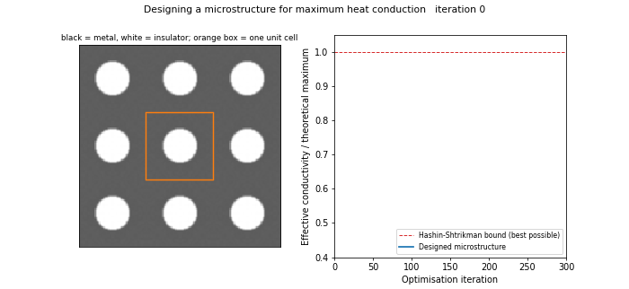

# Computational Homogenisation & Inverse Microstructure Design (FEM)

The microstructures inside a cold plate (pin-fin arrays, lattices, channel networks) are far too fine
to mesh in a full-device simulation. Instead, each region is described by **effective properties**
computed on a single periodic unit cell. This project builds that capability from scratch:

1. **A periodic finite-element homogenisation code** (bilinear Q1 elements) for the effective
   conductivity tensor of any two-phase microstructure.
2. **Verification against exact results:** laminates, Dykhne's checkerboard, Keller's reciprocal
   theorem and the Hashin–Shtrikman bounds.
3. **Inverse homogenisation.** Topology optimisation of the unit cell (adjoint sensitivities, MMA,
   periodic filter, D4 symmetry) to design microstructures that approach the theoretical maximum
   conductivity.
4. **A link to Project 1.** The homogenised material law is compared with the RAMP interpolation used
   in the cold-plate optimiser.



*`figures/microstructure_movie.mp4`: a 3 × 3 tiling of the unit cell evolving from a plain circular hole
into the optimised network, with its conductivity approaching the Hashin–Shtrikman bound. The final
frames show the heat flux through the design.*

## Method

For a unit cell of n × n pixels, the effective tensor is

```
K_ij = (1/|Y|) Σ_e (χ⁰_i − χ_i)_eᵀ  k_e K⁰_e  (χ⁰_j − χ_j)_e ,      K χ_i = F_i  (periodic)
```

- **Periodicity:** opposite boundary nodes are identified, so the mesh is a torus. One sparse LU
  factorisation serves both load cases.
- **Sensitivity:** the problem is self-adjoint, so dK_ij/dρ_e is a per-element energy product, with no
  extra solve. It is checked against finite differences to 10⁻⁶.
- **Design:**
  - SIMP interpolation (p = 3), contrast 1000:1 between conductor and insulator;
  - periodic density filter and Heaviside projection (β up to 32);
  - eight-fold square symmetry, which makes the 2-D design isotropic;
  - MMA, maximising K_xx + K_yy at a fixed conductor fraction;
  - starting from a circular hole, since a uniform grey start is a stationary point.

## Results

All numbers come from `results/summary.json`, produced by `scripts/run_homog.py` (≈ 2 min).

### 1. Verification

| Test | Exact result | FEM |
|---|---|---|
| Laminate, along / across layers | Voigt / Reuss means | **exact to 10⁻¹⁰** |
| Checkerboard, contrast 10 (Dykhne) | k = √(k₁k₂) = 3.162 | 3.444 → 3.193 (n = 16 → 256); converges at h^0.79 because of corner singularities |
| Keller reciprocal theorem, ellipse | K(k₁,k₂) = k₁k₂ R K(k₂,k₁)⁻¹ Rᵀ | error 2.3% → 1.1% → 0.58% (first-order convergence) |
| Conductive discs, f = 5–70% | inside the HS bounds; near Maxwell–Garnett when dilute | all inside the bounds; 1–3% above MG for f ≤ 0.4, rising with f as discs interact |

These checks are exact theorems, not "looks reasonable" comparisons, so they test the periodic boundary
conditions, assembly and energy formula independently (`fig1_verification.png`).

### 2. Optimised microstructures vs. the theoretical limit

No two-phase isotropic microstructure can conduct better than the Hashin–Shtrikman upper bound.

| Conductor fraction | Optimised cell | Simple circular hole | Optimised advantage |
|---|---|---|---|
| **30%** | **98.9%** of the bound | 76.5% of the bound | **+29% conductivity** |
| 50% | 98.1% | 97.3% | +0.8% |
| 70% | 99.5% | 99.8% | none (the circle is already near-optimal) |

The optimiser matters most when material is scarce. At 30% conductor, a circular hole leaves thin necks
that choke heat flow. The optimiser instead builds a diagonal lattice of evenly thick ligaments that
reaches 99% of the theoretical maximum. At high conductor fractions a circular hole is already essentially
optimal, and the optimiser rediscovers it (`fig2_optimal_cells.png`).

### 3. What this means for topology optimisation (link to Project 1)

The cold-plate optimiser treats partly-filled cells with a RAMP interpolation of conductivity. Here is
what a real microstructure with the same coolant fraction delivers (`fig3_material_law_vs_ramp.png`):

| Coolant fraction | 10% | 30% | 50% | 70% |
|---|---|---|---|---|
| FEM: circular coolant holes in metal | 0.82 | 0.55 | 0.33 | 0.15 |
| HS upper bound (best possible) | 0.82 | 0.55 | 0.34 | 0.19 |
| RAMP q = 8 (Project 1) | 0.51 | 0.21 | 0.11 | 0.06 |

RAMP underestimates achievable conductivity by **1.6–3×**. That is intended: it is a penalty that pushes
designs to pure 0/1. It is not a material law. A homogenisation-based (multiscale) optimiser could
instead use graded microstructures and their real effective properties. The holes curve also shows the
**percolation collapse** above ~78.5% coolant, where neighbouring holes touch and the metal network
breaks (conductivity falls from 0.15 to 0.02).

## Conservation and confidence

`conservation()` in `fem.py` checks the solved cell problems (`results/conservation.json`, all three optimised cells):

| Check | Meaning | Worst case |
|---|---|---|
| Nodal residual of K χ = F | local equilibrium (discrete ∇·q = 0) at every node | 1 × 10⁻¹⁴ |
| Hill–Mandel consistency | K from the energy integral = volume-averaged flux response | 4 × 10⁻¹⁵ |
| Section flux | identical heat flux through every column (row) of the cell | 5 × 10⁻¹⁵ |
| Periodicity | the fluctuation χ adds no mean gradient | 5 × 10⁻¹⁹ |
| Symmetry | K_xy = K_yx | 7 × 10⁻¹⁸ |

Together with the exact-theorem verification above (laminates exact to 10⁻¹⁰, Dykhne, Keller, HS bounds),
finite-difference-checked sensitivities, and a unit test enforcing these balances, this gives high confidence that
the effective properties are right.

## Limitations and next steps

- Conductivity only. Effective **permeability** of the same cells (a Stokes cell problem) would give both
  inputs a cold-plate model needs.
- 2-D square pixels, which is the source of the slow checkerboard convergence. Body-fitted or adaptive
  meshes would converge faster.
- Single-objective design. A natural extension is a two-objective conductivity–permeability design,
  mapping the trade-off that a cold-plate microstructure must make.

## Files

| File | Content |
|---|---|
| `src/homog/fem.py` | Periodic Q1 homogenisation, flux post-processing, analytical bounds, test geometries |
| `src/homog/design.py` | Inverse design: periodic filter, projection, D4 symmetry, MMA |
| `scripts/run_homog.py` | Verification, optimal cells, material-law study → `results/`, `figures/` |
| `scripts/make_animation.py` | Movie of the design evolving and heat flowing through it |

**Tests (`tests/`, 9 passing):**
- homogeneous material returns itself, and laminates are exact;
- the tensor is symmetric positive-definite and lies within the Voigt/Reuss bounds;
- the checkerboard converges toward Dykhne, and discs lie within the HS bounds;
- sensitivities match finite differences;
- symmetrisation is a projection, and the filter wraps periodically;
- the optimiser beats a circular hole and exceeds 90% of the bound;
- local and global flux and energy balances hold to round-off.

## Run

```bash
pip install -r requirements.txt imageio-ffmpeg
python -m pytest -q tests          # 9 tests, ~15 s
python scripts/run_homog.py        # ~2 min
python scripts/make_animation.py   # ~1 min
```
